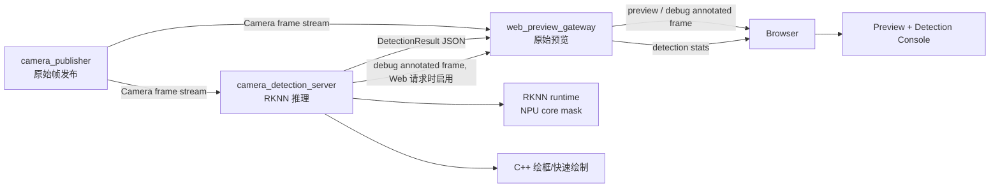
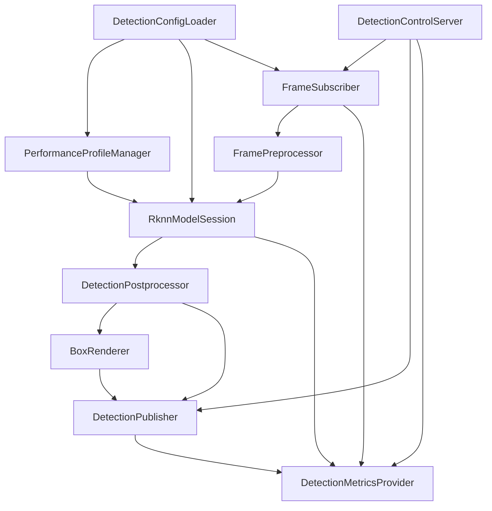
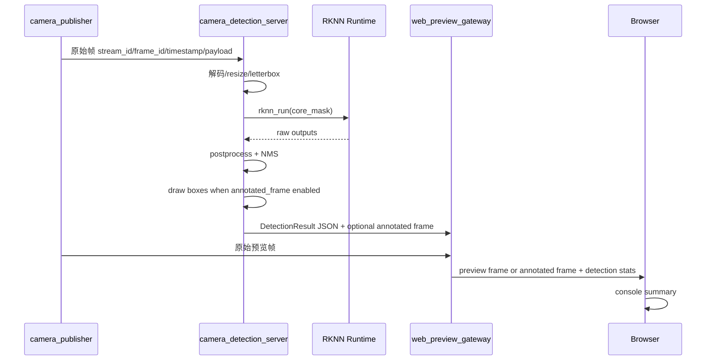
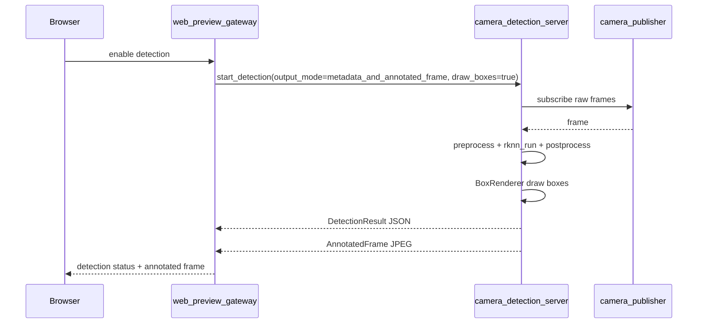
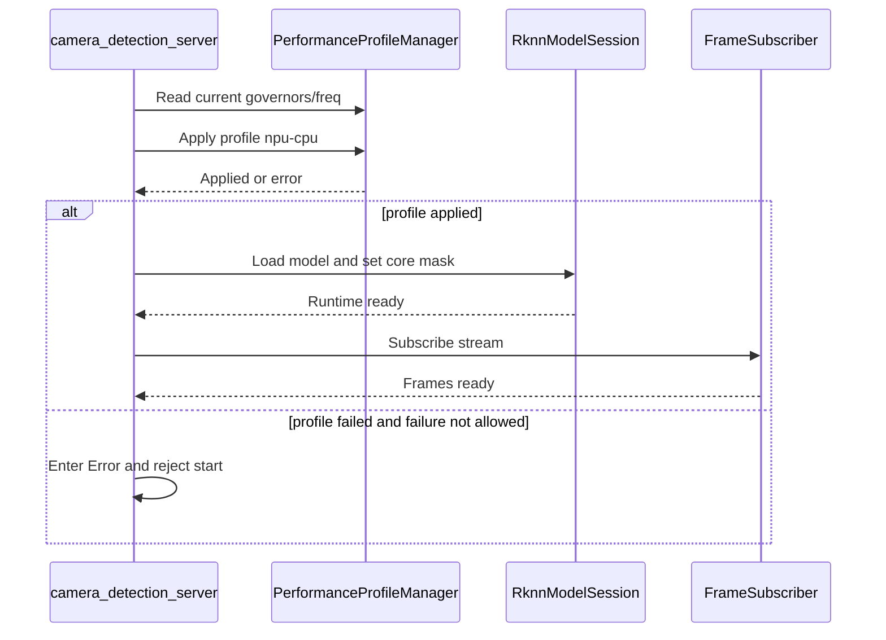
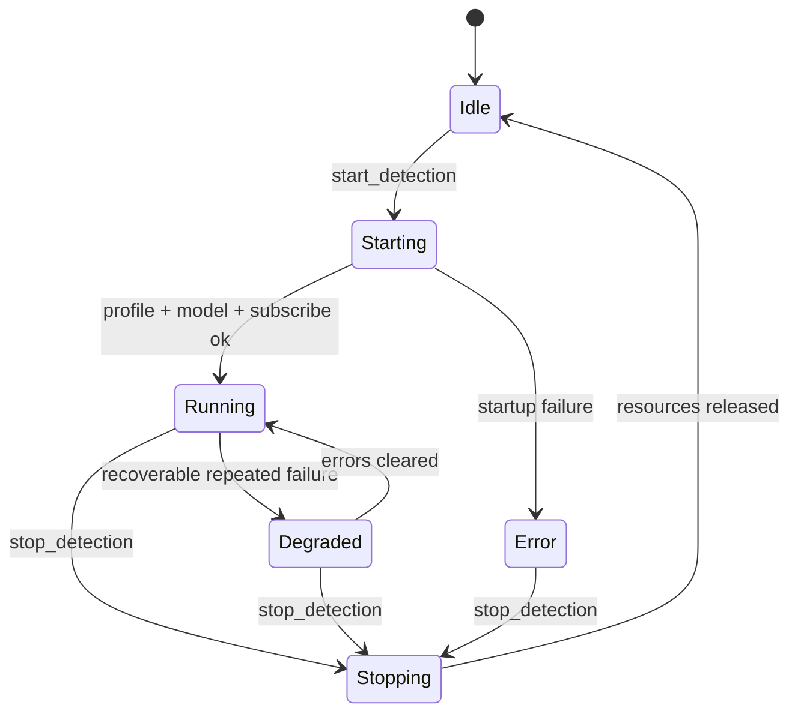
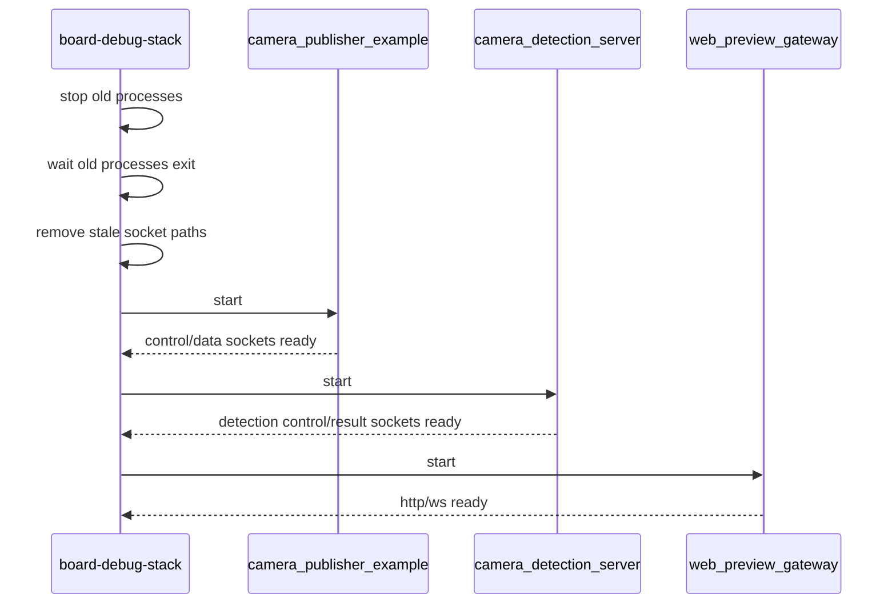

# Camera Target Detection Pipeline 架构设计

**最后更新:** 2026-05-20<br>
**阶段定位:** RK3576 官方 RKNN 新栈、`camera_detection_server`、DetectionResult 发布、Detection control UDS 和 Web Preview 检测开关/状态链路已经打通；当前进入目标检测主线的 P0 收敛阶段<br>
**当前目标:** 更新当前实现基线，完成 P0 收敛后的下一阶段设计：Web 调试启用目标检测时必须显示检测框，绘框由 `camera_detection_server` 侧完成；server 面向真实业务默认仍为 metadata-only；本文只做设计与事实同步，不包含新的 C++ / TypeScript 实现代码

> **文档硬规范**
>
> - 本项目的系统架构图、模块框图、部署拓扑图、数据路径框图和工程结构框图必须使用 `architecture-diagram` skill 生成独立 HTML / inline SVG 图表产物；每个 HTML 图必须同步导出同名 `.svg`，Markdown 中默认直接显示 SVG，并附完整 HTML 图表链接。
> - 时序图、状态机图、纯目录结构图等仍使用 Mermaid fenced code block（语言标识为 `mermaid`）。
> - 禁止新增 ASCII art/text 框图；普通日志、命令输出、代码片段按其原始语言使用 fenced code block。
> - 本文只做架构设计，不包含 C++ / TypeScript 实现代码。

---

## 目录

- [1. 背景与目标](#1-背景与目标)
- [2. 当前 RK3576 NPU 实测结论](#2-当前-rk3576-npu-实测结论)
  - [2.5 板端高性能模式开关](#25-板端高性能模式开关)
- [3. 总体架构](#3-总体架构)
- [4. 进程与职责边界](#4-进程与职责边界)
- [5. 数据流与控制流](#5-数据流与控制流)
- [6. 输出模式与 Web 行为](#6-输出模式与-web-行为)
- [7. 结果数据契约](#7-结果数据契约)
- [8. NPU core 使用策略](#8-npu-core-使用策略)
- [9. 背压、丢帧与时序策略](#9-背压丢帧与时序策略)
- [10. Metrics 与日志](#10-metrics-与日志)
- [11. 状态机与错误处理](#11-状态机与错误处理)
- [12. 当前实现基线与 P0 收敛设计](#12-当前实现基线与-p0-收敛设计)
  - [12.1 当前已完成基线](#121-当前已完成基线)
  - [12.2 P0 收敛目标](#122-p0-收敛目标)
  - [12.3 P0-1 统一板端启动与清理设计](#123-p0-1-统一板端启动与清理设计)
  - [12.4 P0-2 配置与状态契约冻结](#124-p0-2-配置与状态契约冻结)
  - [12.5 P0-3 最小回归入口设计](#125-p0-3-最小回归入口设计)
  - [12.6 P0 明确暂缓项](#126-p0-明确暂缓项)
  - [12.7 P1 Web 调试绘框设计](#127-p1-web-调试绘框设计)
    - [12.7.7 P1 编码准入清单](#1277-p1-编码准入清单)
- [13. P0 验收标准](#13-p0-验收标准)
- [14. 风险与缓解](#14-风险与缓解)
- [15. 已确认决策与待实现细节](#15-已确认决策与待实现细节)
- [16. 代码落地蓝图](#16-代码落地蓝图)
- [17. 配置默认值](#17-配置默认值)
- [18. 构建、部署与运行入口](#18-构建部署与运行入口)
- [19. 测试矩阵](#19-测试矩阵)
- [20. 编码准入结论](#20-编码准入结论)

---

## 1. 背景与目标

CameraSubsystem 当前已经具备稳定的 RK3576 USB 主链路、Web Preview、Codec Server、DataPlaneV2 和 RKNN 官方新栈验证基础。目标检测链路不应直接塞进 `camera_publisher` 或 `web_preview_gateway`，而应和 `camera_codec_server` 一样作为独立扩展服务接入。

推荐新增独立进程：

```text
camera_detection_server
```

第一阶段目标：

1. `camera_detection_server` 作为普通订阅端订阅 CameraSubsystem 原始视频流。
2. 推理使用 RKNN 官方新栈，默认模型入口沿用已跑通的 `yolo11`。
3. 默认只占用一个明确指定的 NPU core，避免单个检测任务吃满全部 NPU。
4. 推理结果以结构化目标框 metadata 发布。
5. 目标框绘制放在 `camera_detection_server` 端完成，前端不承担重型逐帧绘制。
6. `camera_detection_server` 面向真实业务默认 `metadata_only`，不默认绘制图像；Web 调试页面启用检测时必须显式请求 server-side annotated frame。
7. console 每秒刷新一次关键日志，不逐帧刷屏。
8. 第一阶段优先跑通 USB copy path；MIPI/RKISP NV12 DMA-BUF 低拷贝输入后移。

非目标：

1. 不把 RKNN 推理放入 `camera_publisher`。
2. 不让 `web_preview_gateway` 直接持有 RKNN runtime。
3. 不在第一阶段做训练、模型自动下载或云端训练管理。
4. 不把 `rknn-llm` 纳入当前目标检测主线。
5. 不在第一阶段承诺多模型、多任务 NPU 调度器，只保留 core mask 配置边界。
6. 不在第一阶段做前端 Canvas/WebGL 重型绘制；前端只做状态展示、按钮控制和低频 console。

## 2. 当前 RK3576 NPU 实测结论

### 2.1 是否走 NPU

当前板端目标检测 demo 使用的是 RKNN runtime，运行日志包含：

```text
rknn_api/rknnrt version: 2.3.2 (...), driver version: 0.9.7
```

同时，`rknn_benchmark` 对 `core_mask` 的变化会产生明显推理性能差异，可以确认当前推理路径不是 CPU-only 路径。

### 2.2 core mask 语义

RKNN C API 中 `rknn_set_core_mask` 暴露以下 mask：

| mask | 含义 |
|------|------|
| `0` | auto |
| `1` | NPU core 0 |
| `2` | NPU core 1 |
| `4` | NPU core 2 |
| `3` | NPU core 0 + core 1 |
| `7` | NPU core 0 + core 1 + core 2 |

说明：官方 `rknn_benchmark` 文档仍写有“仅 RK3588 支持 core mask”的历史备注；但当前 RK3576 + `rknnrt 2.3.2` 实测可以传入不同 mask，并观察到性能差异。工程决策以板端实测为准，但实现上必须保留 mask 设置失败时的日志与 fallback。

### 2.3 yolo11n 实测数据

测试条件：

1. 板端：RK3576 / Debian12 / `driver 0.9.7`
2. Runtime：`rknnrt 2.3.2`
3. 模型：`yolo11n`，`640x640`，INT8
4. 工具：官方 `rknn_benchmark`
5. 每组：`120` 次循环，输入为 `bus.jpg`
6. CPU 负载：按 `/proc/stat` 总 CPU delta 粗略估算
7. 内存：按 `MemAvailable` delta 粗略估算，短测会受 page cache 和输出文件影响
8. IO：benchmark 会保存 `rt_output*.npy`，因此写入扇区主要反映测试工具输出，不代表后续流式推理链路

| NPU mask | core 配置 | 平均耗时 ms | 推理 FPS | CPU 粗略占用 | MemAvailable delta | 读扇区 | 写扇区 | 结论 |
|----------|-----------|-------------|----------|--------------|--------------------|--------|--------|------|
| `0` | auto | `37.36` | `26.77` | `3.10%` | `-2348 KB` | `0` | `20528` | 接近单核，不适合作为独占策略 |
| `1` | core 0 | `37.76` | `26.49` | `3.15%` | `-2028 KB` | `0` | `20512` | 可作为默认独占 core |
| `2` | core 1 | `39.14` | `25.55` | `3.03%` | `-1020 KB` | `0` | `19424` | 可作为可配置独占 core |
| `4` | core 2 | `36.01` | `27.77` | `3.06%` | `-1876 KB` | `0` | `19360` | 当前最快单核 |
| `3` | core 0 + core 1 | `26.93` | `37.14` | `3.72%` | `-1440 KB` | `0` | `19360` | 双核有明显收益 |
| `7` | core 0 + core 1 + core 2 | `37.65` | `26.56` | `3.59%` | `-2396 KB` | `0` | `19360` | 当前未体现三核收益，不建议默认使用 |

当前架构结论：

1. 第一阶段目标检测服务默认使用单核 mask，默认值确定为 `1`，保留 `2` / `4` 可配置。
2. 如果后续单任务确实需要更高吞吐，可以显式配置 `3`，但不能默认全开。
3. `7` 当前实测没有收益，不能把“三核全开”当成性能假设。
4. Web 预览链路当前 USB 输入大约 15 FPS，默认 governor 下单核 `yolo11n` 约 25 FPS，单路实时检测在算力上可行。

### 2.4 理论帧率与当前瓶颈分析

官方 `rknn_model_zoo` 当前基准表给出 `RK3576 @single_core` 的 `yolo11n INT8 640x640` 性能为 `77.9 FPS`。从模型复杂度和 RK3576 单核算力看，`50+ FPS` 是合理预期。

我们第一次实测只有 `25-28 FPS`，原因不是 `yolo11n` 模型太大，而是板端频率策略没有进入最高性能状态。板端实测频率状态：

| 项 | 当前值 |
|----|--------|
| NPU `cur_freq` | `300000000` |
| NPU `max_freq` | `950000000` |
| NPU governor | `rknpu_ondemand` |
| CPU policy0 governor | `ondemand` |
| CPU policy4 governor | `ondemand` |

临时将 NPU/CPU governor 切到 `performance` 后，`core0` 单核同一模型同一输入的结果为：

| 模式 | NPU 频率 | 平均耗时 | 推理 FPS |
|------|----------|----------|----------|
| 默认 `rknpu_ondemand` | `300 MHz` 起步 | `37.76 ms` | `26.49` |
| 临时 `performance` | `950 MHz` | `17.08 ms` | `58.56` |

结论：

1. `50+ FPS` 可以达到，至少在 `core0 + performance governor` 下已经实测到 `58.56 FPS`。
2. 与官方 `77.9 FPS` 仍有差距，可能来自 DDR/CPU 频率、benchmark 输入路径、系统后台负载、驱动版本和板厂 Debian 默认调频策略。
3. 目标检测服务第一阶段默认进入已验证的 `npu-cpu` performance profile，避免用户开启检测后仍运行在 `300 MHz` 起步的 ondemand 状态。
4. 后续如果要追官方基准，需要单独做性能专项：锁定 NPU/CPU/DDR、关闭无关后台进程、避免 benchmark 输出 `.npy` 干扰、拆分 preprocess/inference/postprocess 耗时。

建议落地策略：

1. `camera_detection_server` 默认仍使用 `npu_core_mask=1`。
2. 服务启动时记录 NPU governor、`cur_freq`、`max_freq`。
3. 提供 `--performance-profile=none|npu|npu-cpu|full` 配置，默认 `npu-cpu`。
4. 默认启动必须尝试切换 NPU + CPU governor；如果权限不足或 sysfs 节点不存在，服务进入 `Error` 状态并输出明确错误，除非用户显式传入 `--allow-performance-profile-failure=1`。
5. 板端调试脚本可通过 `DETECTION_PERFORMANCE_PROFILE=none` 临时关闭该行为，用于对比调频影响。

### 2.5 板端高性能模式开关

当前工程可参考官方 RKNN LLM 目录中的 `rknn-llm/scripts/fix_freq_rk3576.sh`，但不能原样照搬到本项目主线。该脚本面向 LLM 压测，包含 GPU/DMC 频率设置，并尝试把 RK3576 NPU 固定到 `1000000000`。当前板端 `/sys/class/devfreq/27700000.npu/max_freq` 实测为 `950000000`，因此目标检测链路第一阶段采用更保守、已验证的 governor 方案。

已验证的一键启用命令：

```bash
sudo sh -c 'echo performance > /sys/class/devfreq/27700000.npu/governor; echo performance > /sys/devices/system/cpu/cpufreq/policy0/scaling_governor; echo performance > /sys/devices/system/cpu/cpufreq/policy4/scaling_governor'
```

验证命令：

```bash
cat /sys/class/devfreq/27700000.npu/governor
cat /sys/class/devfreq/27700000.npu/cur_freq
cat /sys/class/devfreq/27700000.npu/max_freq
cat /sys/devices/system/cpu/cpufreq/policy0/scaling_governor
cat /sys/devices/system/cpu/cpufreq/policy4/scaling_governor
```

当前板端验证结果：

| 项 | 结果 |
|----|------|
| NPU governor | `performance` |
| NPU `cur_freq` | `950000000` |
| NPU `max_freq` | `950000000` |
| CPU policy0 governor | `performance` |
| CPU policy4 governor | `performance` |
| `yolo11n` core0 benchmark | `17.08 ms / 58.56 FPS` |

恢复默认调频命令：

```bash
sudo sh -c 'echo rknpu_ondemand > /sys/class/devfreq/27700000.npu/governor; echo ondemand > /sys/devices/system/cpu/cpufreq/policy0/scaling_governor; echo ondemand > /sys/devices/system/cpu/cpufreq/policy4/scaling_governor'
```

`camera_detection_server` 的实现约束：

1. 默认等价于 `--performance-profile=npu-cpu`，启动时先设置 governor，再初始化 RKNN runtime。
2. 只设置 NPU 与 CPU governor，不默认改 GPU/DMC，避免为目标检测扩大系统副作用。
3. 启动日志必须打印切换前后的 NPU/CPU governor 与 NPU `cur_freq/max_freq`。
4. 服务正常退出时不强制恢复 governor，避免多个检测/AI 任务并行时互相踩配置；恢复动作交给板端 debug stack 或用户显式命令。
5. 若后续需要生产级策略，应由统一板端启动脚本或 systemd unit 管理性能档，而不是每个 AI 服务各自抢占全局频率。

## 3. 总体架构



核心原则：

1. `camera_publisher` 仍然只负责采集与帧发布。
2. `camera_detection_server` 是普通订阅者，不直接打开 `/dev/video*`。
3. `web_preview_gateway` 只做结果转发和状态聚合，不持有 RKNN runtime。
4. 真实业务默认只消费 DetectionResult metadata；Web 调试开启检测时必须显示 detection server 输出的 annotated frame。
5. 绘制工作在 detection server 侧完成，前端不做逐帧目标框绘制。

### 3.1 detection server 内部模块

`camera_detection_server` 第一阶段按以下模块拆分。这里的拆分是代码实现边界，不要求每个模块都独立成库；但接口职责必须保持清晰，避免后续把 RKNN、Web、绘制和订阅逻辑揉在一个主循环里。

| 模块 | 职责 | 关键输入 | 关键输出 | 第一阶段边界 |
|------|------|----------|----------|--------------|
| `DetectionConfigLoader` | 解析 CLI / 环境变量，生成不可变启动配置 | CLI、默认值、模型路径 | `DetectionServerConfig` | 不读取远端配置中心 |
| `PerformanceProfileManager` | 设置并校验 NPU/CPU governor，采样频率状态 | `performance_profile`、sysfs | profile 状态、错误信息 | 默认 `npu-cpu`，不默认改 GPU/DMC |
| `RknnModelSession` | 加载 `yolo11.rknn`，设置 core mask，执行 `rknn_run` | 模型、core mask、预处理 tensor | raw output、runtime 信息 | 单模型单 session |
| `FrameSubscriber` | 订阅 CameraSubsystem 原始帧，维护小队列 | `stream_id`、subscriber socket | 最新帧、丢帧计数 | copy path，先不接 MIPI DMA-BUF |
| `FramePreprocessor` | 解码、resize、letterbox、格式转换 | 原始帧 payload | RKNN input tensor、letterbox metadata | USB JPEG/MJPEG 优先 |
| `DetectionPostprocessor` | 解析 YOLO 输出，做阈值过滤与 NMS | raw output、阈值 | object list | 固定 yolo11 输出适配 |
| `BoxRenderer` | 在 server 侧绘制目标框，生成 annotated frame | 原始/解码帧、object list | annotated frame | 第一阶段可用 CPU 绘制，后续再接 RGA/NEON |
| `DetectionPublisher` | 发布 DetectionResult JSON 与 annotated frame | 结果、帧、metrics | JSON line、独立 annotated UDS | 不直接提供 HTTP |
| `DetectionControlServer` | 接收 start/stop/config/status 控制命令 | Gateway 控制消息 | response、状态切换 | JSON line，沿用 codec server 风格 |
| `DetectionMetricsProvider` | 维护 metrics 快照，供 Gateway/日志读取 | 计数器、耗时、状态 | metrics snapshot | 每秒聚合，不逐帧刷屏 |

模块依赖方向：



实现约束：

1. `RknnModelSession` 不能依赖 Web/Gateway 类型。
2. `FrameSubscriber` 不知道模型、类别、NMS 等推理细节。
3. `BoxRenderer` 只接收后处理后的 bbox，不直接解析 RKNN raw output。
4. `DetectionPublisher` 负责协议封装，但不负责推理策略。
5. `PerformanceProfileManager` 必须可单独测试 sysfs 路径缺失、权限不足和读取失败。

## 4. 进程与职责边界

| 进程 | 职责 | 明确不做 |
|------|------|----------|
| `camera_publisher` | 独占 Camera 设备，发布原始帧 | 不加载 RKNN，不做检测 |
| `camera_detection_server` | 订阅原始帧，执行预处理、RKNN 推理、后处理、C++ 绘框，发布检测结果和可选 annotated frame | 不直接访问 Camera 设备，不提供 HTTP 服务 |
| `web_preview_gateway` | 聚合原始预览、检测状态、检测结果和 annotated frame，转发给浏览器 | 不持有 RKNN runtime，不做模型推理，不做目标框绘制 |
| Web 前端 | 展示原始预览或 annotated frame、每秒 console 摘要、检测开关 | 不逐帧刷日志，不做重型绘制 |

建议工程目录：

| 路径 | 作用 |
|------|------|
| `extensions/detection_server/` | 目标检测服务扩展 |
| `extensions/detection_server/src/` | RKNN runtime 封装、订阅、推理 session、结果发布 |
| `extensions/detection_server/include/` | 内部头文件 |
| `extensions/detection_server/tests/` | 结果序列化、状态机、配置解析测试 |
| `docs/TARGET_DETECTION_PIPELINE_DESIGN.md` | 本设计文档 |

## 5. 数据流与控制流

### 5.1 数据流



### 5.2 控制流

第一阶段控制命令只需要覆盖：

| 命令 | 方向 | 说明 |
|------|------|------|
| `start_detection` | Web/Gateway -> Detection | 启动某个 `stream_id` 的检测 |
| `stop_detection` | Web/Gateway -> Detection | 停止检测 |
| `set_detection_config` | Web/Gateway -> Detection | 设置 `core_mask`、阈值、输出模式、推理间隔 |
| `get_detection_status` | Web/Gateway -> Detection | 查询 session 状态和 metrics |

控制协议建议沿用 codec server 的 JSON line 风格，减少新协议复杂度。

### 5.3 控制协议字段

控制面第一阶段使用 Unix Domain Socket + JSON line，避免引入 HTTP server 或 protobuf。每条请求必须包含 `request_id`，响应必须原样带回。

#### start_detection

```json
{
  "type": "start_detection",
  "request_id": "req-001",
  "stream_id": "default0",
  "config": {
    "model_path": "/home/luckfox/CameraSubsystem/models/yolo11.rknn",
    "labels_path": "/home/luckfox/CameraSubsystem/models/coco_80_labels_list.txt",
    "npu_core_mask": 1,
    "score_threshold": 0.25,
    "nms_threshold": 0.45,
    "output_mode": "metadata_only",
    "infer_every_n_frames": 1,
    "draw_boxes": false,
    "performance_profile": "npu-cpu"
  }
}
```

说明：上面的 `start_detection` 示例是通用业务默认值。Web 调试页面启用检测时，Gateway 必须覆盖为 `output_mode=metadata_and_annotated_frame` 且 `draw_boxes=true`，详见第 6.2 节。

成功响应：

```json
{
  "type": "detection_response",
  "request_id": "req-001",
  "ok": true,
  "stream_id": "default0",
  "state": "running"
}
```

失败响应：

```json
{
  "type": "detection_response",
  "request_id": "req-001",
  "ok": false,
  "stream_id": "default0",
  "error_code": "PERFORMANCE_PROFILE_FAILED",
  "message": "failed to set /sys/class/devfreq/27700000.npu/governor to performance"
}
```

#### stop_detection

`stop_detection` 只停止指定 `stream_id` 的检测 session，不影响 `camera_publisher` 和原始 Web 预览。

```json
{
  "type": "stop_detection",
  "request_id": "req-002",
  "stream_id": "default0"
}
```

停止成功后应释放 subscriber、RKNN input/output tensor、annotated frame buffer 和控制面 session 状态。第一阶段不要求恢复 governor。

#### set_detection_config

运行期可修改的字段限制在不会破坏 RKNN session 的轻量项：

| 字段 | 运行期是否允许 | 处理方式 |
|------|----------------|----------|
| `score_threshold` | 是 | 下一帧生效 |
| `nms_threshold` | 是 | 下一帧生效 |
| `output_mode` | 是 | 下一次发布生效 |
| `draw_boxes` | 是 | 下一帧生效 |
| `infer_every_n_frames` | 是 | 下一帧调度生效 |
| `npu_core_mask` | 否 | 返回 `CONFIG_RESTART_REQUIRED` |
| `model_path` | 否 | 返回 `CONFIG_RESTART_REQUIRED` |
| `performance_profile` | 否 | 返回 `CONFIG_RESTART_REQUIRED` |

不允许运行期热切换 `npu_core_mask`，原因是它会改变 RKNN runtime 调度语义，也容易掩盖多任务 NPU 资源分配问题。需要切换 core 时必须 stop 再 start。

#### get_detection_status

状态响应必须同时包含业务状态、性能档状态、模型状态和最近 metrics：

```json
{
  "type": "detection_status",
  "request_id": "req-003",
  "stream_id": "default0",
  "state": "running",
  "model_name": "yolo11",
  "npu_core_mask": 1,
  "performance_profile": {
    "name": "npu-cpu",
    "applied": true,
    "npu_governor": "performance",
    "npu_cur_freq_hz": 950000000,
    "npu_max_freq_hz": 950000000,
    "cpu_policy0_governor": "performance",
    "cpu_policy4_governor": "performance"
  },
  "metrics": {
    "input_fps": 15.4,
    "infer_fps": 15.2,
    "dropped_frames": 0,
    "latency_ms_avg": 23.6,
    "latency_ms_p95": 31.4,
    "object_count": 2
  },
  "last_error": ""
}
```

### 5.4 错误码

第一阶段错误码固定为以下集合，避免每个模块自由拼字符串：

| 错误码 | 含义 | 典型处理 |
|--------|------|----------|
| `INVALID_CONFIG` | 配置字段非法 | 拒绝 start/config |
| `PERFORMANCE_PROFILE_FAILED` | governor 设置或验证失败 | 默认拒绝启动 |
| `MODEL_LOAD_FAILED` | RKNN 模型加载失败 | 拒绝启动 |
| `CORE_MASK_FAILED` | `rknn_set_core_mask` 失败 | 拒绝启动 |
| `SUBSCRIBE_FAILED` | 订阅原始帧失败 | session 进入 Error |
| `FRAME_DECODE_FAILED` | 解码或输入格式不支持 | 计数并丢帧，连续失败进入 Degraded |
| `INFERENCE_FAILED` | `rknn_run` 或 output 读取失败 | session 进入 Error |
| `PUBLISH_FAILED` | 结果发布失败 | 计数并继续，连续失败进入 Degraded |

## 6. 输出模式与 Web 行为

### 6.1 输出模式

| 模式 | 默认 | 说明 | 实现阶段 |
|------|------|------|----------|
| `metadata_only` | server 默认 | 只发布结构化目标框、类别、置信度、帧号和耗时 | 已有主线 |
| `metadata_and_annotated_frame` | Web 调试开启检测时强制请求 | detection server 同时发布 metadata 和已绘制目标框的 JPEG 调试帧 | P1 必做 |
| `web_overlay` | 否 | Web 前端基于 metadata 在原始预览上逐帧绘制目标框 | 暂缓，不作为当前方案 |

默认组合按调用方区分：

```text
camera_detection_server default:
  output_mode=metadata_only
  draw_boxes=false

Web debug start_detection:
  output_mode=metadata_and_annotated_frame
  draw_boxes=true
  web_overlay=false
```

原因：

1. 真实业务通常只消费结构化目标框，默认绘制在图像上没有意义，还会引入 CPU/JPEG 编码开销。
2. Web 调试的用户目标是“看见检测是否正确”，因此点击检测开关后必须能看到检测框。
3. 绘框放在 detection server 侧，Web 只显示已编码图像，避免浏览器在多路场景下承担逐帧绘制。
4. annotated frame 第一阶段使用 CPU 绘制 + JPEG 输出；后续若 CPU 开销不可接受，再引入 RGA/NEON 或硬件 JPEG 优化。

### 6.2 Web 调试绘框策略

Web Preview 的检测开关不是通用业务 API，而是板端调试入口。其行为必须固定：

1. 用户在 Web stream card 上点击“开启检测”时，Gateway 发送 `start_detection` 或 `set_detection_config`，必须携带：
   - `output_mode="metadata_and_annotated_frame"`
   - `draw_boxes=true`
2. 用户点击“关闭检测”时，Gateway 发送 `stop_detection`，并清空该 stream 的检测画面与 console 状态。
3. 如果 detection server 不支持 annotated frame 或绘框失败，Gateway 必须把该状态暴露给前端，不允许只显示 metadata 而让用户误以为“已开启检测但没有框”。
4. Web 前端不做逐帧 bbox 绘制；只做：
   - 显示原始 preview 或 server annotated preview
   - 展示每秒 detection summary
   - 展示最近错误
5. Web 调试模式下，metadata 仍必须发布，因为 console、状态和外部 client 都依赖 DetectionResult。



### 6.3 annotated frame 同步规则

annotated frame 不是新的 Camera 源，它是 detection server 对某个原始 `frame_id` 的派生结果。同步规则如下：

1. annotated frame 必须携带原始 `stream_id`、`frame_id`、`timestamp_ns`。
2. Gateway 收到 annotated frame 后，只能替换同一 `stream_id` 的检测视图，不能覆盖原始预览流。
3. Web 只显示每个 `stream_id` 最新 annotated frame；如果新到的 annotated frame 的 `frame_id` 小于当前显示帧，必须丢弃。
4. metadata 和 annotated frame 可以分开到达；Web console 以 metadata 为准，画面以 annotated frame 为准。
5. stop detection 后，Web 必须清空该 stream 的 detection overlay/console，但原始预览继续显示。

### 6.4 Web console 行为

Web console 每秒刷新一次摘要，不逐帧刷屏。

建议字段：

| 字段 | 说明 |
|------|------|
| `stream_id` | 当前检测流 |
| `model_name` | 例如 `yolo11` |
| `npu_core_mask` | 当前 RKNN core mask |
| `input_fps` | detection server 实际接收帧率 |
| `infer_fps` | 完成推理帧率 |
| `dropped_frames` | 因队列或节流丢弃的帧 |
| `latency_ms_avg` | 平均端到端检测耗时 |
| `latency_ms_p95` | p95 检测耗时 |
| `object_count` | 最近一秒目标数 |
| `last_error` | 最近错误 |

console 交互规则：

1. 每个 stream card 增加一个检测开关，默认关闭。
2. 开启后 Web 发送 `start_detection`，按钮进入 pending 状态，直到收到 `running` 或错误响应；该命令必须请求 `metadata_and_annotated_frame` 和 `draw_boxes=true`。
3. 关闭后 Web 发送 `stop_detection`，立即停止展示 detection console 的持续刷新。
4. console 每秒最多追加一行摘要，最多保留最近 60 行。
5. 错误状态必须显示 `error_code` 和简短 message，不显示原始堆栈。

## 7. 结果数据契约

DetectionResult 建议使用 JSON line 作为第一阶段结果协议：

```json
{
  "type": "detection_result",
  "stream_id": "default0",
  "frame_id": 12345,
  "timestamp_ns": 1790000000000,
  "model": {
    "name": "yolo11",
    "runtime": "rknnrt",
    "runtime_version": "2.3.2",
    "core_mask": 1
  },
  "image": {
    "width": 1920,
    "height": 1080,
    "letterbox_width": 640,
    "letterbox_height": 640
  },
  "metrics": {
    "preprocess_ms": 3.2,
    "inference_ms": 37.8,
    "postprocess_ms": 2.1,
    "total_ms": 43.1
  },
  "objects": [
    {
      "class_id": 5,
      "label": "bus",
      "score": 0.941,
      "bbox_xyxy": [95, 136, 554, 438],
      "bbox_norm_xyxy": [0.1484, 0.2125, 0.8656, 0.6844]
    }
  ]
}
```

契约要求：

1. `stream_id` 必须贯穿结果、状态、日志和 Web event。
2. `frame_id` 必须来自原始帧，不允许 detection server 自己生成无关联帧号。
3. bbox 同时给 pixel 坐标和 normalized 坐标，便于 Web overlay 和后续外部消费。
4. `core_mask` 必须进入结果和状态，便于确认任务没有默认吃满全部 NPU。
5. 结果协议第一阶段使用 JSON line；后续高频或多模型场景再考虑二进制协议。

### 7.1 输入帧契约

第一阶段输入只承诺当前 USB 主链路可验证路径：

| 输入项 | 第一阶段约束 |
|--------|--------------|
| `stream_id` | 必须由 publisher/control 面贯通，不能写死为 `default` |
| `frame_id` | 必须来自原始帧描述，不允许 detection server 自增替代 |
| `timestamp_ns` | 使用原始帧 timestamp；缺失时才由接收时间补齐并打 warning |
| pixel format | 优先支持当前 USB JPEG/MJPEG 路径 |
| memory type | 第一阶段 copy path；DMA-BUF/RGA 低拷贝输入暂缓 |
| frame ownership | subscriber 处理完成后必须及时 release，不因推理阻塞 release |

不在第一阶段处理：

1. MIPI/RKISP 多平面 NV12 live path。
2. RKNN 直接 import DMA-BUF。
3. RGA 零拷贝 resize/letterbox。
4. 多 stream 同时检测的 NPU core 自动调度。

### 7.2 输出帧契约

annotated frame 第一阶段建议复用 Web preview 已有可显示封装，优先输出 JPEG/RGB 后再由 Gateway 转发。为了避免把格式选择卡死，设计上要求输出层保留以下抽象字段：

| 字段 | 说明 |
|------|------|
| `stream_id` | 原始流 |
| `frame_id` | 对应原始帧 |
| `timestamp_ns` | 对应原始时间戳 |
| `encoding` | `jpeg`、`rgb` 或后续扩展 |
| `width` / `height` | annotated frame 尺寸 |
| `payload_size` | 输出 payload 字节数 |

第一阶段更推荐 `jpeg`，因为现有 Web preview 链路已经围绕浏览器可显示帧工作；RGA/MPP/硬件 JPEG 优化后移。

## 8. NPU core 使用策略

### 8.1 默认策略

默认配置：

```text
npu_core_mask=1
```

允许配置：

| 配置 | 是否允许 | 说明 |
|------|----------|------|
| `1` | 是 | 独占 core 0，已拍板为默认 |
| `2` | 是 | 独占 core 1 |
| `4` | 是 | 独占 core 2，当前单核实测最快 |
| `3` | 是 | 双核，只有用户明确需要更高吞吐时开启 |
| `7` | 不建议默认 | 当前实测无收益，不能作为默认 |
| `0` | 不建议默认 | auto 不满足“任务绑定独立 NPU core”的目标 |

### 8.2 调度原则

1. 单个检测任务默认只占一个 NPU core。
2. `core_mask` 是 detection session 的显式配置项，不隐藏在代码常量里。
3. 如果 `rknn_set_core_mask` 失败，服务必须进入 `Degraded` 或 `Error` 状态，并把失败原因写入 status，不静默 fallback 到 all core。
4. 多模型并行时，必须由上层配置分配 core，例如 detection=1、另一个任务=2、第三个任务=4。

### 8.3 PerformanceProfileManager 策略

profile 枚举：

| profile | NPU | CPU policy0/4 | GPU/DMC | 默认 |
|---------|-----|---------------|---------|------|
| `none` | 不修改 | 不修改 | 不修改 | 否 |
| `npu` | `performance` | 不修改 | 不修改 | 否 |
| `npu-cpu` | `performance` | `performance` | 不修改 | 是 |
| `full` | 暂缓 | 暂缓 | 暂缓 | 否 |

`full` 第一阶段不实现，只保留枚举占位。原因是 GPU/DMC 属于全局资源，目标检测链路当前没有证据证明必须改它们。

启动顺序：



失败策略：

1. 默认 `allow_performance_profile_failure=false`。
2. sysfs 节点不存在、写入失败、写入后回读不匹配都视为失败。
3. 失败时不初始化 RKNN runtime，直接返回 `PERFORMANCE_PROFILE_FAILED`。
4. 用户显式允许失败时，服务可以继续启动，但 status 必须标记 `performance_profile.applied=false`，Web console 必须显示 warning。
5. 服务退出不自动恢复 governor，避免多个 AI 服务并发时互相覆盖；恢复由统一 debug stack、systemd unit 或用户命令完成。

## 9. 背压、丢帧与时序策略

目标检测不是录制，第一阶段不追求逐帧必达。推荐策略：

1. detection server 订阅原始帧后使用小队列，例如 `max_queue_depth=2`。
2. 推理繁忙时丢弃旧帧，只保留最新帧，避免检测显示延迟持续增长。
3. 目标检测默认关闭；用户开启后默认 `infer_every_n_frames=1`，即每帧都进入检测链路。
4. 如果推理耗时超过输入帧周期，仍采用小队列 + 丢旧保新，不让延迟无限增长。
5. annotated frame 必须携带 `stream_id + frame_id + timestamp_ns`，Web 端只显示最新帧。

推荐线程模型：

| 线程 | 职责 | 阻塞边界 |
|------|------|----------|
| control thread | 处理 start/stop/status/config | 不执行推理 |
| subscriber thread | 接收原始帧并放入小队列 | 不等待 RKNN |
| inference thread | 取最新帧、预处理、推理、后处理、绘框、发布 | 可阻塞在 RKNN |
| metrics thread | 每秒聚合日志和 status snapshot | 不访问长耗时路径 |

队列策略：

1. `max_queue_depth=2`。
2. 队列满时丢弃最旧帧，保留最新帧。
3. 被丢弃的帧如果持有 DataPlaneV2 lease，必须先 release。
4. `infer_every_n_frames=1` 表示每个进入 inference thread 的最新帧都推理，不表示队列必须保留每一帧。
5. 当输入 15 FPS、单核 performance 下推理 58 FPS 时，理论上不应出现持续丢帧；如果出现，优先检查 decode/resize/draw/publish，而不是 NPU。

延迟预算第一阶段参考值：

| 阶段 | 目标 | 说明 |
|------|------|------|
| decode + preprocess | `< 15 ms` | USB JPEG/MJPEG 可能成为主要 CPU 开销 |
| RKNN inference | `< 25 ms` | performance + core0 实测 benchmark `17.08 ms` |
| postprocess + draw | `< 10 ms` | yolo11 object 数量有限 |
| publish + gateway | `< 10 ms` | metadata 很小，annotated frame 取决于编码 |
| end-to-end p95 | `< 80 ms` | 单路 USB 调试目标，不作为生产 SLA |

## 10. Metrics 与日志

Detection server 需要提供自己的 metrics provider，后续接入 `MetricsAggregator` 或由 gateway 单独转发。

建议指标：

| 指标 | 说明 |
|------|------|
| `detection_input_frames` | 收到的原始帧数 |
| `detection_inferred_frames` | 完成推理的帧数 |
| `detection_dropped_frames` | 因背压或节流丢弃的帧数 |
| `detection_result_count` | 输出结果数 |
| `detection_last_object_count` | 最近一帧目标数 |
| `detection_preprocess_ms_avg` | 平均预处理耗时 |
| `detection_inference_ms_avg` | 平均 RKNN 推理耗时 |
| `detection_postprocess_ms_avg` | 平均后处理耗时 |
| `detection_total_ms_p95` | p95 总耗时 |
| `detection_npu_core_mask` | 当前 core mask |
| `detection_npu_cur_freq_hz` | 采样到的 NPU 当前频率 |
| `detection_npu_governor` | 当前 NPU governor |
| `detection_performance_profile_applied` | 性能档是否已生效 |
| `detection_profile_failure_count` | 性能档设置失败次数 |
| `detection_decode_failure_count` | 解码失败次数 |
| `detection_publish_failure_count` | 发布失败次数 |

日志规则：

1. 服务端日志可以逐状态变化输出，但不要逐帧输出完整检测结果。
2. Web console 每秒聚合一次，最多显示最近 N 条。
3. 关键错误必须包含 `stream_id`、`frame_id`、`core_mask`、`model_path`。

建议每秒摘要日志格式：

```text
detection_summary stream=default0 state=running model=yolo11 core_mask=1 profile=npu-cpu profile_applied=1 input_fps=15.4 infer_fps=15.2 dropped=0 latency_avg_ms=23.6 latency_p95_ms=31.4 objects=2 npu_freq=950000000
```

启动关键日志必须包含：

```text
detection_profile before npu_governor=rknpu_ondemand npu_cur=300000000 npu_max=950000000 cpu0=ondemand cpu4=ondemand
detection_profile after npu_governor=performance npu_cur=950000000 npu_max=950000000 cpu0=performance cpu4=performance
detection_runtime model=yolo11 runtime=rknnrt runtime_version=2.3.2 driver_version=0.9.7 core_mask=1
```

禁止日志行为：

1. 禁止逐帧打印完整 JSON result。
2. 禁止把 bbox 列表直接刷到主日志；bbox 只进入 metadata 输出。
3. 禁止在 Web console 中一帧一行刷新。

## 11. 状态机与错误处理

目标检测 session 状态机：



状态定义：

| 状态 | 含义 | Web 行为 |
|------|------|----------|
| `Idle` | 未开启检测 | 按钮可开启，console 清空 |
| `Starting` | 正在设置性能档、加载模型、订阅帧 | 按钮 pending |
| `Running` | 正常推理和发布 | 显示 console/annotated frame |
| `Degraded` | 可恢复异常，例如连续 decode/publish 失败 | 显示 warning，原始预览不受影响 |
| `Error` | 不可继续，例如 profile/model/core mask 失败 | 显示错误，停止检测输出 |
| `Stopping` | 正在释放资源 | 按钮 pending |

资源释放顺序：

1. 停止接收新的控制启动请求。
2. 停止 subscriber 接收，release 未处理帧。
3. 停止 inference thread，释放 RKNN input/output 资源。
4. flush 或关闭 DetectionPublisher。
5. 更新 metrics/status 为 `Idle` 或 `Error`。
6. 不自动恢复 governor。

错误处理原则：

1. 启动前置条件失败必须 fail fast，不能带病运行。
2. 运行时单帧 decode 失败只计数和丢帧，不立即停止 session。
3. 连续 decode/publish 失败超过阈值进入 `Degraded`。
4. RKNN runtime 运行失败进入 `Error`，需要 stop/start 恢复。
5. detection server 崩溃时 Gateway 只标记 detection unavailable，原始 preview 继续。

## 12. 当前实现基线与 P0 收敛设计

### 12.1 当前已完成基线

截至 2026-05-20，目标检测主线已经不是“从零开始设计”，而是已经具备以下可运行基线：

1. `camera_detection_server` 已独立成进程，具备 `DetectionServerConfig`、`PerformanceProfileManager`、`RknnModelSession`、`DetectionSession`。
2. 已打通板端真实推理闭环：
   - `camera_publisher_example`
   - `camera_detection_server`
   - `web_preview_gateway`
3. 已完成真实链路：
   - `订阅 -> MJPEG 解码 -> letterbox RGB tensor -> rknn_run -> yolo11 后处理 -> DetectionResult 发布`
4. 已完成最小控制面：
   - `get_detection_status`
   - `set_detection_config`
   - `stop_detection`
   - `start_detection`
5. 已完成 Web 最小接入：
   - stream card 检测开关
   - detection status 摘要
   - Gateway `/status` 聚合 detection 字段
6. RK3576 板端已验证：
   - `stop -> start -> set_detection_config` 可闭环工作
   - `stop -> start` 后 session counters 正确清零
   - Web 可稳定看到 detection 状态变化

当前仍未收敛的，不是“推理功能缺失”，而是工程交付面：

1. 板端启动方式仍依赖调试脚本和人工顺序，需固化。
2. detection 配置、Web 展示字段和结果契约需要冻结，避免后续反复改协议。
3. 回归入口需要收敛到最小集合，避免在脚本层继续扩张。
4. `annotated frame`、MIPI 低拷贝输入、多路调度都不应再挤占当前 P0。

### 12.2 P0 收敛目标

当前 P0 不是新增能力，而是把现有可运行基线收口为可交接状态。P0 只做以下三件事：

1. **统一板端启动与清理**
   - 让 `publisher + detection_server + web_preview_gateway` 有唯一推荐启动入口。
   - 消除 socket path、后台进程、旧进程退出时序、日志目录的人工差异。

2. **冻结配置与状态/结果契约**
   - detection server CLI、Gateway status 字段、Web 展示摘要、DetectionResult JSON 字段统一口径。
   - 在不破坏现有链路的前提下，把“当前真实使用的字段”定成第一版稳定契约。

3. **收敛最小回归入口**
   - 保留一条最小板端回归路径，用于验证启动、状态查询、控制命令和结果摘要。
   - 不建设新的测试框架，不新增复杂 smoke 维度。

### 12.3 P0-1 统一板端启动与清理设计

P0 默认不再要求用户手工拼接多个命令。推荐收口为一个统一入口，例如现有板端 debug stack 的 detection 子命令，职责如下：

| 动作 | 职责 | 约束 |
|------|------|------|
| `start` | 清理旧进程、清理旧 socket、拉起三进程、写日志路径 | 必须等待旧进程真正退出后再复用 socket path |
| `stop` | 按顺序停止 gateway、detection、publisher | 允许重复调用 |
| `status` | 汇总进程、socket、关键日志、HTTP `/status` 摘要 | 不依赖浏览器 |
| `restart` | 串行执行 `stop -> start` | 不保留旧 session 统计 |

推荐启动顺序：



启动收口约束：

1. publisher 的 control/data socket ready 是 detection server 启动前置条件。
2. detection 的 control/result socket ready 是 gateway detection proxy 正常工作的前置条件。
3. 所有后台进程必须脱离 ssh 会话；不能再依赖“当前终端不退出”的偶然行为。
4. 覆盖板端二进制前必须先停进程，禁止在运行中直接替换可执行文件。
5. 统一日志目录，至少固定：
   - `publisher.log`
   - `detection.log`
   - `gateway.log`
   - `runtime-status.json` 或同等摘要文件

### 12.4 P0-2 配置与状态契约冻结

P0 要把“当前真实用到的字段”冻结下来，避免后续继续一边开发一边改名。

#### 12.4.1 detection server 启动配置

第一版稳定配置只保留以下业务相关字段：

| 类别 | 字段 |
|------|------|
| 输入 | `stream_id`、`camera_control_socket`、`camera_data_socket` |
| 模型 | `model_path`、`labels_path`、`npu_core_mask` |
| 推理策略 | `infer_every_n_frames`、`score_threshold`、`nms_threshold` |
| 结果输出 | `control_socket`、`result_socket`、P1 `annotated_socket` |
| 性能档 | `performance_profile`、`allow_performance_profile_failure` |

冻结规则：

1. P0 不再新增与单路 USB 主线无关的 detection CLI。
2. `output_mode`、`draw_boxes` 在 P0 不作为验收主线，但 P1 Web 调试绘框必须使用这两个字段，不再新增平行开关。
3. Gateway 和调试 client 修改 detection 配置时，只允许改：
   - `infer_every_n_frames`
   - `score_threshold`
   - `nms_threshold`
4. `model_path`、`labels_path`、`npu_core_mask` 在 P0 作为启动期固定配置，不做运行期热切换。

#### 12.4.2 Gateway detection status 字段

Gateway 第一版稳定 status 至少保留以下字段：

| 字段 | 含义 |
|------|------|
| `available` | detection control socket 是否可达 |
| `state` | `idle/running/error/...` |
| `model_name` | 当前模型名 |
| `npu_core_mask` | 当前 core mask |
| `performance_profile.applied` | 高性能档是否真正生效 |
| `config.infer_every_n_frames` | 当前推理节流配置 |
| `config.score_threshold` | 当前阈值 |
| `config.nms_threshold` | 当前阈值 |
| `metrics.input_frames` | 当前 session 输入帧累计 |
| `metrics.inferred_frames` | 当前 session 推理帧累计 |
| `metrics.last_object_count` | 最近一帧目标数 |
| `last_error` | 最近错误摘要 |

冻结规则：

1. 这些字段一旦给 Web 使用，就按第一版 API 对待，后续只能增字段，不能随意改名。
2. session 计数语义必须统一为“当前 detection session 累计值”，不能混入旧 session。
3. `available=false` 和 `state=error` 语义不同：
   - `available=false`：Gateway 连不上 detection server
   - `state=error`：detection server 活着，但 session 失败

#### 12.4.3 DetectionResult JSON 第一版冻结范围

P0 冻结 metadata-only 主线契约，最少字段如下：

| 类别 | 字段 |
|------|------|
| 身份 | `stream_id`、`frame_id`、`timestamp_ns` |
| 模型 | `model.name`、`model.runtime_version`、`model.core_mask` |
| 图像 | `image.width`、`image.height`、`image.letterbox_width`、`image.letterbox_height` |
| 耗时 | `metrics.preprocess_ms`、`metrics.inference_ms`、`metrics.postprocess_ms`、`metrics.total_ms` |
| 结果 | `objects[].class_id`、`label`、`score`、`bbox_xyxy`、`bbox_norm_xyxy` |

冻结规则：

1. P0 不把 `annotated frame` 作为结果契约冻结前置条件。
2. 业务 client 当前只消费 metadata summary，不依赖图像结果。
3. P1 引入 `annotated frame` 时，必须作为与 metadata 平行的可选输出，不得反向绑死 metadata 契约。

### 12.5 P0-3 最小回归入口设计

P0 回归目标是验证“主线还能稳定工作”，不是扩展测试平台。

推荐最小回归流程：

1. 启动统一板端入口。
2. 查询 Gateway `/status`，确认 detection 字段可见。
3. 走一遍控制面：
   - `stop_detection`
   - `start_detection`
   - `set_detection_config`
4. 读取 detection result client 或同等摘要，确认：
   - `parse_fail=0`
   - `input_frames` 增长
   - `inferred_frames` 增长
5. 停止 detection server，确认原始预览不受影响。

最小回归不要求：

1. 自动截图。
2. 长时间 benchmark dashboard。
3. 多路拓扑。
4. `annotated frame` 图像层验证。

P0 推荐保留的人工/脚本化判定点：

| 检查点 | 通过条件 |
|--------|----------|
| 进程启动 | 三进程均存活，socket/HTTP ready |
| detection status | Gateway `/status` 含 detection block |
| 控制面 stop/start | state 在 `idle/running` 间正确切换 |
| 配置更新 | `infer_every_n_frames`、阈值修改后 status 立即反映 |
| 结果摘要 | `input_frames`、`inferred_frames` 增长，`parse_fail=0` |
| 隔离性 | detection 停止后原始 preview 继续 |

### 12.6 P0 明确暂缓项

以下事项不进入当前 P0，避免目标检测链路再次失焦：

1. `annotated frame` 端到端交付与 Web 切换。该项是 P1 必做，不再继续作为长期暂缓项。
2. 前端绘框或复杂 console 视图。前端逐帧绘框继续暂缓，P1 只允许 server-side 绘框。
3. MIPI/RKISP NV12 DMA-BUF 低拷贝输入。
4. 多模型、多路 camera detection 调度。
5. 长时间压测框架和复杂 smoke 报告体系。
6. LLM 或其他 NPU 任务联合调度。

### 12.7 P1 Web 调试绘框设计

P0 已经收口启动、控制、状态和 metadata 主线。下一步 P1 只做一件事：Web 调试开启目标检测时必须可见检测框，但不把绘框负担放到浏览器。

#### 12.7.1 目标与非目标

P1 目标：

1. `camera_detection_server` 默认仍为 `metadata_only + draw_boxes=false`。
2. Web Preview 开启检测时，Gateway 必须请求 `metadata_and_annotated_frame + draw_boxes=true`。
3. `camera_detection_server` 在 server 侧完成 bbox 绘制，并输出 JPEG annotated frame。
4. Web 显示 annotated frame，同时继续展示每秒 detection summary。
5. detection 关闭后，Web 回到原始 preview，清空检测画面和最近检测状态。

P1 非目标：

1. 不做 Web Canvas/WebGL bbox overlay。
2. 不做多路检测调度。
3. 不做 MIPI/RGA 低拷贝绘框。
4. 不做复杂前端控制台或逐帧结果列表。
5. 不改变 DetectionResult metadata 第一版字段。

#### 12.7.2 数据通道选择

P1 固定新增与 metadata 平行的 annotated frame UDS 通道，不复用 DetectionResult JSON Line socket：

| 通道 | 内容 | 原因 |
|------|------|------|
| `/tmp/camera_subsystem_detection_result.sock` | DetectionResult JSON Line，bbox、类别、score、latency、frame identity | 轻量、适合 console 和业务订阅 |
| `/tmp/camera_subsystem_detection_annotated.sock` | AnnotatedFrame binary header + JPEG payload | 避免 JSON 膨胀，避免 text/binary 混在同一 socket |

拍板理由：

1. 现有 result socket 已被调试 client 按 JSON line 消费，混入 binary payload 会破坏现有 parser。
2. annotated frame 是调试图像流，生命周期、背压和丢帧策略都应与 metadata 分离。
3. 多一个 UDS socket 的管理成本低于在一个字节流里同时处理 JSON line 和 binary frame 的复杂度。
4. Gateway 可以把 annotated frame 转成现有浏览器 WebSocket binary frame，不要求前端直接理解 detection server 内部 UDS 协议。

新增默认 socket：

```text
/tmp/camera_subsystem_detection_annotated.sock
```

新增配置项：

| 参数 | 默认值 | 说明 |
|------|--------|------|
| `--annotated-socket` | `/tmp/camera_subsystem_detection_annotated.sock` | detection server 发布 annotated frame 的 UDS |
| `--detection-annotated-socket` | `/tmp/camera_subsystem_detection_annotated.sock` | web_preview_gateway 订阅 annotated frame 的 UDS |

#### 12.7.3 输出契约

Annotated frame 使用固定小端二进制 header + payload，不使用 JSON 包裹 JPEG。

```cpp
// 文档契约，实际代码放入 detection_server/annotated_frame_protocol.h
constexpr uint32_t kDetectionAnnotatedFrameMagic = 0x4146524d; // "AFRM"
constexpr uint32_t kDetectionAnnotatedFrameVersion = 1;
constexpr uint32_t kDetectionAnnotatedFrameHeaderSize = 128;

enum class DetectionAnnotatedEncoding : uint32_t
{
    kJpeg = 1,
};

#pragma pack(push, 1)
struct DetectionAnnotatedFrameHeader
{
    uint32_t magic;
    uint32_t version;
    uint32_t header_size;
    uint32_t encoding;
    uint64_t frame_id;
    uint64_t timestamp_ns;
    uint32_t width;
    uint32_t height;
    uint32_t object_count;
    uint32_t payload_size;
    char stream_id[64];
    uint8_t reserved[16];
};
#pragma pack(pop)
```

字段语义：

| 字段 | 说明 |
|------|------|
| `magic` | 固定 `0x4146524d`，ASCII `"AFRM"` |
| `version` | 固定 `1` |
| `header_size` | 固定 `128` |
| `encoding` | 第一版固定 `1`，表示 `jpeg` |
| `frame_id` | 对应原始帧 |
| `timestamp_ns` | 对应原始时间戳 |
| `width` / `height` | annotated frame 尺寸 |
| `object_count` | 该帧绘制目标数 |
| `payload_size` | JPEG payload 字节数 |
| `stream_id` | NUL 结尾字符串，最长 63 字节，当前单路默认为 `default0` |

接收方必须校验：

1. `magic/version/header_size` 完全匹配。
2. `encoding == jpeg`。
3. `payload_size > 0` 且不超过实现配置的上限，建议第一版上限 `8 MiB`。
4. `stream_id` 非空，且能映射到 Gateway 当前 stream card。
5. `frame_id` 小于当前已显示 annotated frame 时丢弃。

Gateway 转发到浏览器时，不直接透传 `DetectionAnnotatedFrameHeader`。Gateway 应把 JPEG payload 封装成现有 `WebFrameHeader + Payload`，并设置：

| WebFrameHeader 字段 | 值 |
|---------------------|----|
| `stream_id` | 当前 `stream_id -> stream_index` 映射值 |
| `frame_id` | annotated header 的 `frame_id` |
| `timestamp_ns` | annotated header 的 `timestamp_ns` |
| `width/height` | annotated header 的 `width/height` |
| `pixel_format` | `WebPixelFormat::kJpeg` |
| `payload_size` | JPEG payload 字节数 |
| `transform_flags` | `kTransformNone` |

说明：浏览器端已经支持 JPEG `WebFrameHeader`，因此 P1 不新增浏览器 binary frame 协议；只需要让 store 能区分“当前显示的是原始 preview 还是 detection annotated preview”。

#### 12.7.4 Gateway 与 Web 行为

Gateway 行为：

1. Web 开启检测时，向 detection control 发送 `start_detection`：
   - `output_mode="metadata_and_annotated_frame"`
   - `draw_boxes=true`
2. Gateway 连接 `/tmp/camera_subsystem_detection_annotated.sock`，读取 `DetectionAnnotatedFrameHeader + payload`。
3. Gateway 将 annotated frame 转为现有 `WebFrameHeader + JPEG payload` 后广播给浏览器。
4. Gateway 按 `stream_id` 缓存最近 annotated frame 状态，不缓存大量历史帧。
5. 如果 annotated frame 超过 2 秒没有更新，但 DetectionResult 仍在增长，Gateway 必须在 status 中暴露 `annotated_stale=true`。
6. 如果 detection server 不可用或绘框失败，Gateway 继续保持原始预览可用，并在 detection status 中报告错误。

Web 行为：

1. 检测开启且 annotated frame 可用时，stream card 显示 annotated frame。
2. 检测开启但 annotated frame 不可用时，stream card 显示原始 preview，并在检测状态区显示“检测框画面不可用”的错误。
3. 检测关闭后，stream card 立即回到原始 preview。
4. Web 不解析 bbox 并逐帧绘制，只消费状态、summary 和可显示 JPEG。

Gateway status 中 P1 新增字段：

| 字段 | 含义 |
|------|------|
| `detection.config.output_mode` | 当前 detection output mode |
| `detection.config.draw_boxes` | 当前是否请求 server 绘框 |
| `detection.annotated.available` | Gateway 是否连接 annotated socket 且收到过合法帧 |
| `detection.annotated.stale` | annotated frame 是否超过 2 秒未更新 |
| `detection.annotated.frame_id` | 最近 annotated frame id |
| `detection.annotated.timestamp_ns` | 最近 annotated frame timestamp |
| `detection.annotated.object_count` | 最近 annotated frame 绘制目标数 |
| `detection.annotated.error` | annotated 通道最近错误 |

这些字段只增不改，不破坏 P0 已冻结字段。

#### 12.7.5 代码实施顺序

P1 必须按以下顺序小步实现：

1. **默认值修正**
   - `DetectionServerConfig::output_mode = metadata_only`
   - `DetectionServerConfig::draw_boxes = false`
   - 单测更新默认值，保证业务默认不绘框。
2. **AnnotatedFrame 协议**
   - 新增 `annotated_frame_protocol.h`
   - 新增 `AnnotatedFrame` 数据结构
   - 单测覆盖 header size、magic、payload size、stream_id 截断/非法值。
3. **BoxRenderer**
   - CPU 绘制 bbox 到可编码图像。
   - 第一版允许只支持当前 USB JPEG decode 后的 RGB/RGBA buffer；不为 MIPI/NV12 做低拷贝优化。
   - 单测覆盖坐标 clamp、空 objects、越界 bbox、超小目标框。
4. **JPEG 编码策略**
   - 第一版优先复用现有可用 JPEG 编码/图像工具；如果工程内没有稳定 JPEG encoder，则先输出绘制后的 RGB 并在 Gateway 侧转换为当前可显示 JPEG 的方案不得落地，必须回到文档修订。
   - 不允许引入大型图像库；若必须新增依赖，需要先单独评审。
5. **DetectionPublisher 扩展**
   - 新增 annotated socket listener 与 client 管理。
   - `metadata_and_annotated_frame && draw_boxes=true` 时发布 annotated frame。
   - annotated 发布失败只增加计数和状态错误，不影响 `PublishResult()`。
6. **Gateway 接收与转发**
   - 新增 `DetectionAnnotatedFrameClient`，独立线程读取 annotated socket。
   - 转成 `WebFrameHeader + JPEG payload` 广播给浏览器。
   - status 增加 `detection.annotated.*` 字段。
7. **Web 前端切换**
   - 检测开启时使用 annotated frame 更新显示。
   - 检测关闭时清空 annotated 状态并恢复原始 preview。
   - 不做 Canvas bbox overlay。
8. **RK3576 smoke**
   - 更新 `rk3576-detection-p0-smoke.sh` 或新增轻量 P1 smoke。
   - 验证 Web 开启检测后 `annotated.available=true`、`stale=false`、`frame_id` 增长。
   - 浏览器人工确认能看到检测框。

P1 建议拆分为 2 到 3 个提交：

1. `[目标检测] 固化绘框默认值与 annotated frame 协议`
2. `[目标检测] 发布 server 侧 annotated frame`
3. `[目标检测] 接入 Web 调试检测框显示`

#### 12.7.6 验收标准

P1 通过条件：

| 类别 | 验收项 |
|------|--------|
| 默认行为 | 直接启动 `camera_detection_server` 时默认 `metadata_only`，不绘制、不发布 annotated frame |
| Web 行为 | Web 开启检测时自动请求绘框，不需要用户理解 `draw_boxes` 配置 |
| 画面 | 浏览器能看到 server 侧绘制的检测框 |
| 性能 | 单路 USB 下原始 preview 不断流，detection summary 每秒刷新 |
| 隔离 | annotated frame 发布失败不影响 DetectionResult metadata 和原始 preview |
| 关闭 | 停止检测后 annotated frame 清空，Web 回到原始 preview |

P1 最小验证命令：

```bash
cd CameraSubsystem
./scripts/build.sh
./scripts/build-rk3576.sh
./extensions/web_preview/scripts/build-gateway-rk3576.sh
cd extensions/web_preview/web && npm run build
```

板端验证：

```bash
cd CameraSubsystem
BOARD_HOST=192.168.31.9 BOARD_USER=luckfox BOARD_PASSWORD=luckfox \
  ./scripts/deploy-rk3576-web-debug.sh

cd CameraSubsystem
./scripts/rk3576-detection-p0-smoke.sh
```

P1 还必须补一个 Web 可见框检查。自动化只要求 status 判定：

```text
detection.annotated.available == true
detection.annotated.stale == false
detection.annotated.frame_id 持续增长
```

浏览器人工检查：

```text
http://192.168.31.9:8080
```

打开检测开关后，画面中必须能看到 server 侧绘制的目标框；关闭检测后必须回到原始预览。

#### 12.7.7 P1 编码准入清单

进入 P1 编码前，不再保留以下未决问题：

| 决策项 | 结论 |
|--------|------|
| server 默认是否绘框 | 否，默认 `metadata_only + draw_boxes=false` |
| Web 调试开启检测是否必须有框 | 是，Gateway 必须请求 `metadata_and_annotated_frame + draw_boxes=true` |
| 绘框在哪里做 | `camera_detection_server` 侧 C++ 绘制 |
| 前端是否绘制 bbox | 否 |
| annotated frame 是否塞进 JSON | 否 |
| annotated frame 是否复用 result socket | 否，新增 `/tmp/camera_subsystem_detection_annotated.sock` |
| annotated frame 编码 | 第一版固定 JPEG |
| Gateway 到浏览器协议 | 复用现有 `WebFrameHeader + JPEG payload` |
| metadata 契约是否改变 | 否，只增 annotated frame 平行通道 |
| MIPI/RGA 是否进入本阶段 | 否 |

P1 第一刀允许写代码的范围：

1. 修改 `DetectionServerConfig` 默认值为 `metadata_only + draw_boxes=false`。
2. 新增 `annotated_frame_protocol.h` 和对应单测。
3. 为 deployment / gateway config 增加 `annotated_socket` 参数透传。
4. 不接 RKNN 主循环、不接 Gateway 广播、不接 Web UI。

P1 第一刀不允许做：

1. 修改 Web 页面显示逻辑。
2. 修改 detection inference 主循环。
3. 引入图像库。
4. 修改 `DetectionResult` JSON 字段名。
5. 改动 Camera 主链路或 codec server。

## 13. P0 验收标准

P0 收敛完成后，必须满足以下验收项，未满足不得标记为“目标检测主线已收口”：

| 类别 | 验收项 | 判定方式 |
|------|--------|----------|
| 启动入口 | 存在唯一推荐板端启动方式 | 不需要人工拼接三进程命令 |
| 启动时序 | 不再出现旧进程 `unlink` 新 socket 的竞态 | 重启后 detection subscriber 不出现 `connect(path)=ENOENT` |
| 进程管理 | 后台进程不依赖 ssh 会话存活 | 退出 ssh 后服务仍在 |
| 配置边界 | 业务配置来源收口 | 运行期只允许更新 `infer_every_n_frames/score_threshold/nms_threshold` |
| 状态契约 | Gateway detection status 字段稳定 | `available/state/config/metrics/last_error` 可稳定读取 |
| 结果契约 | DetectionResult metadata 第一版冻结 | `stream_id/frame_id/timestamp_ns/objects/latency` 字段稳定输出 |
| 控制面 | `get/set/start/stop` 完整可用 | 板端真实执行通过 |
| 统计语义 | session counters 不串历史值 | `stop -> start` 后从新 session 重新累计 |
| 回归入口 | 保留一条最小验证路径 | 能完成启动、status、stop/start/set、结果摘要检查 |
| 隔离性 | detection 故障不拖垮原始预览 | detection unavailable 时 preview 仍正常 |

当前 P0 不包含：

1. `annotated frame` 必须可见。
2. Web 图像层目标框显示。
3. 多路 camera 检测联调。

说明：`annotated frame` 已根据当前调试需求提升为 P1 必做项，但不回填到 P0 验收，避免破坏已经收口的 P0 基线。

## 14. 风险与缓解

| 风险 | 级别 | 缓解 |
|------|------|------|
| `core_mask=7` 在 RK3576 上无收益 | P1 | 默认单核；双核/三核必须显式配置；文档记录实测结果 |
| annotated frame 与原始预览切换不同步 | P1 | annotated frame 携带 `stream_id/frame_id/timestamp_ns`，Web 只显示最新帧 |
| USB JPEG decode + RKNN 预处理吃 CPU | P2 | 第一阶段先测量；后续可用 RGA 或 MIPI NV12 低拷贝输入优化 |
| detection 队列堆积导致延迟增长 | P1 | 小队列 + 丢旧保新 + `infer_every_n_frames` |
| RKNN runtime 与旧 SDK runtime 混用 | P1 | 新栈独立目录和独立部署；不覆盖 `Omni3576-sdk` |
| detection server 崩溃影响预览 | P1 | 独立进程；Gateway 只显示 detection unavailable，不影响原始预览 |
| JSON 结果过大或频率过高 | P2 | metadata-only 每帧结果可控；console 每秒聚合；后续再考虑二进制协议 |
| 默认 governor 导致 FPS 低于预期 | P1 | detection server 默认进入 `npu-cpu` performance profile；启动时校验 NPU/CPU governor 与频率，失败进入 Error 或显式降级 |
| 服务直接改 governor 带来全局副作用 | P1 | 默认只改 NPU/CPU，不改 GPU/DMC；退出不自动恢复；生产环境后续收敛到统一启动脚本或 systemd unit |
| performance profile 需要 sudo 权限 | P1 | 开发板 debug 环境允许 sudo；生产环境用 systemd unit 或启动脚本预授权；失败必须可观测 |
| annotated frame 编码增加 CPU 开销 | P2 | 先测量 CPU 绘制路径；必要时只开 metadata_only；RGA/NEON 优化后移 |
| metadata 与 annotated frame 乱序 | P2 | 使用 `stream_id/frame_id/timestamp_ns` 去重，只显示最新帧 |
| 过早接入多路/多模型导致主线失焦 | P1 | 第一阶段只做单 USB 单模型单 core；多路调度等 MIPI/多摄像头真实输入到位后再开 |

## 15. 已确认决策与待实现细节

以下决策已经确认，可以作为第一阶段编码输入：

1. **默认 NPU core：** 默认仅启用 `core0`，即 `npu_core_mask=1`。
2. **绘框方式：** 前端不做重型逐帧绘制；目标框绘制放在 `camera_detection_server` 端，使用 C++ 绘制路径，后续可引入 RGA/NEON 优化。
3. **结果协议：** 第一阶段接受 JSON line，不引入 protobuf 或复杂二进制协议。
4. **推理节流：** 目标检测默认关闭；用户开启后默认每帧推理，即 `infer_every_n_frames=1`。
5. **模型选择：** 第一阶段固定 `yolo11.rknn`，链路稳定后再评估替换模型。
6. **性能档：** `camera_detection_server` 默认启用 `npu-cpu` performance profile，失败默认拒绝启动。
7. **第一阶段输入路径：** 仅承诺 USB copy path；MIPI/RKISP/DMA-BUF/RGA 低拷贝后移。
8. **annotated frame 格式：** P1 使用 JPEG 输出，复用 Web preview 当前浏览器友好的图像显示路径。
9. **绘框实现：** P1 参考/复用 RKNN model zoo `image_drawing` 的 CPU 绘制思路，并封装为 `BoxRenderer`，不把 model zoo 示例代码散落在业务主循环里。
10. **默认绘框策略：** `camera_detection_server` 默认不绘制；Web 调试开启检测时必须显式请求 server-side 绘框。

当前无阻塞 P1 编码的未决策事项。以下内容只作为后续优化方向，不阻塞 P1 Web 调试绘框开工：

1. RGA/NEON 绘框加速。
2. MIPI/RKISP NV12 DMA-BUF 低拷贝输入。
3. 多模型、多 stream 的 NPU core 分配器。

## 16. 代码落地蓝图

本节保留第一阶段以来的文件级蓝图，并在第 12.7 节补充 P1 绘框实现入口。实现时应按阶段拆分提交，避免一次性把 RKNN、控制面、Web、绘框和脚本全部塞进同一个改动。

### 16.1 目录与文件清单

新增目录：

```text
extensions/detection_server/
```

第一阶段新增文件：

| 文件 | 类型 | 责任 |
|------|------|------|
| `extensions/detection_server/CMakeLists.txt` | 构建 | 定义 `camera_detection_server` 和可测试的内部静态库 |
| `extensions/detection_server/include/detection_server/detection_config.h` | 头文件 | 配置结构、默认值、枚举 |
| `extensions/detection_server/include/detection_server/detection_types.h` | 头文件 | DetectionResult、bbox、metrics、状态枚举 |
| `extensions/detection_server/include/detection_server/performance_profile_manager.h` | 头文件 | sysfs governor 管理接口 |
| `extensions/detection_server/include/detection_server/rknn_model_session.h` | 头文件 | RKNN runtime 封装接口 |
| `extensions/detection_server/include/detection_server/frame_preprocessor.h` | 头文件 | 解码、resize、letterbox 接口 |
| `extensions/detection_server/include/detection_server/detection_postprocessor.h` | 头文件 | YOLO 输出解析与 NMS 接口 |
| `extensions/detection_server/include/detection_server/box_renderer.h` | 头文件 | CPU 绘框与 JPEG 输出接口 |
| `extensions/detection_server/include/detection_server/annotated_frame_protocol.h` | 头文件 | `DetectionAnnotatedFrameHeader` 二进制协议 |
| `extensions/detection_server/include/detection_server/detection_publisher.h` | 头文件 | JSON metadata 与 annotated frame 发布接口 |
| `extensions/detection_server/include/detection_server/detection_session.h` | 头文件 | session 状态机、线程生命周期 |
| `extensions/detection_server/src/*.cpp` | 实现 | 对应头文件实现 |
| `extensions/detection_server/src/camera_detection_server_app.cpp` | 入口 | CLI、启动、信号处理 |
| `extensions/detection_server/tests/*.cpp` | 单测 | 配置、profile、序列化、状态机、NMS |
| `scripts/rk3576-detection-server-smoke.sh` | 板端 smoke | 编排 publisher/detection/web 的最小验证 |

修改文件：

| 文件 | 修改内容 |
|------|----------|
| `CMakeLists.txt` | 增加 `extensions/detection_server` 子目录，可用选项控制是否构建 |
| `scripts/build-rk3576.sh` | 确认 detection server 跟随 RK3576 交叉编译 |
| `scripts/rk3576-build-deploy-debug.sh` | 部署 detection server、模型、labels 和 smoke 脚本 |
| `scripts/rk3576-board-debug-stack.sh` | 增加可选 detection 启动/停止入口 |
| `extensions/web_preview/` | 只做 detection control/status proxy 和 UI 开关，不做前端绘框 |

第一阶段不修改：

| 路径 | 原因 |
|------|------|
| `src/camera/` | detection 是订阅端，不改变采集主链路 |
| `src/ipc/camera_data_plane_v2.*` | 第一阶段 copy path，不改 fd 协议 |
| `extensions/codec_server/` | detection 与 codec 平行，不复用 codec session manager |
| `Omni3576-sdk/` | 不覆盖官方 SDK 文件 |

### 16.2 构建目标

建议 CMake 目标：

| target | 类型 | 说明 |
|--------|------|------|
| `camera_detection_server_core` | static library | 配置、profile、RKNN wrapper、postprocess、renderer、publisher、session |
| `camera_detection_server` | executable | 进程入口 |
| `test_detection_config` | unit test | CLI/default/is-valid |
| `test_performance_profile_manager` | unit test | 用临时目录 mock sysfs |
| `test_detection_result_json` | unit test | JSON 字段完整性和转义 |
| `test_detection_postprocessor` | unit test | bbox decode/NMS 边界 |
| `test_detection_session_state` | unit test | 状态机 start/stop/error |

RKNN 依赖接入策略：

1. RK3576 交叉编译时链接官方新栈 `rknnrt 2.3.2`。
2. 本机 x86_64 单测默认不链接 RKNN runtime，`RknnModelSession` 用接口抽象或编译选项隔离。
3. 如果本机缺 RKNN runtime，仍必须能编译和运行非 RKNN 单测。
4. RKNN 真实推理只在 RK3576 smoke 中验证。

### 16.3 数据结构字段

核心数据结构字段必须先落到 `detection_types.h`，再由各模块引用。字段命名保持 snake_case，JSON 字段与结构字段一致。

| 结构 | 必需字段 |
|------|----------|
| `DetectionBox` | `class_id`、`label`、`score`、`x1`、`y1`、`x2`、`y2`、`nx1`、`ny1`、`nx2`、`ny2` |
| `DetectionResult` | `stream_id`、`frame_id`、`timestamp_ns`、`model_name`、`runtime_version`、`driver_version`、`npu_core_mask`、`image_width`、`image_height`、`letterbox_width`、`letterbox_height`、`preprocess_ms`、`inference_ms`、`postprocess_ms`、`total_ms`、`objects` |
| `AnnotatedFrame` | `stream_id`、`frame_id`、`timestamp_ns`、`encoding`、`width`、`height`、`object_count`、`payload` |
| `DetectionMetricsSnapshot` | `state`、`input_frames`、`inferred_frames`、`dropped_frames`、`decode_failures`、`publish_failures`、`input_fps`、`infer_fps`、`latency_avg_ms`、`latency_p95_ms`、`last_object_count`、`npu_core_mask`、`npu_governor`、`npu_cur_freq_hz`、`performance_profile_applied`、`last_error` |
| `PerformanceProfileSnapshot` | `profile`、`applied`、`npu_governor`、`npu_cur_freq_hz`、`npu_max_freq_hz`、`cpu_policy0_governor`、`cpu_policy4_governor`、`error_code`、`message` |

### 16.4 模块实现顺序

推荐小步提交顺序：

1. **配置与类型层：** `detection_config`、`detection_types`、JSON 序列化、单测。
2. **性能档层：** `PerformanceProfileManager`，用 mock sysfs 单测覆盖成功、权限失败、回读不匹配。
3. **RKNN wrapper 骨架：** `RknnModelSession` 接口和 RK3576 编译接入，先支持加载模型、查询 runtime、设置 core mask。
4. **后处理与绘框：** `DetectionPostprocessor` + `BoxRenderer`，用 fixture 覆盖 NMS 和 bbox 坐标。
5. **session 骨架：** 状态机、线程生命周期、队列、metrics，不接 Web。
6. **订阅与发布：** 接 `CameraSubscriberClient`，先输出 metadata JSON，再按 P1 增加 JPEG annotated frame。
7. **Gateway/Web 最小接入：** detection 开关、status proxy、每秒 console；P1 增加 annotated frame 显示。
8. **板端 smoke：** 单 USB、core0、performance profile、Web 可见结果。

每一步都要求本机可构建；涉及 RKNN 真实运行的步骤再增加 RK3576 验证。

### 16.5 关键实现约束

1. `camera_detection_server_app.cpp` 只负责解析参数、装配对象和处理信号，不写业务逻辑。
2. `PerformanceProfileManager` 不依赖 RKNN，也不依赖 detection session。
3. `RknnModelSession` 不处理 JSON、不处理 Web、不处理 subscriber。
4. `DetectionSession` 只编排模块和状态机，不直接写 sysfs、不直接解析 RKNN raw output。
5. 任何线程退出都必须可重复调用 stop，不允许析构时阻塞无限等待。
6. JSON 序列化必须集中实现，禁止多处手写拼接不同格式。
7. 控制面错误码必须使用第 5.4 节固定集合。

## 17. 配置默认值

第一阶段 CLI 默认值如下，除非板端验证证明不可用，否则实现不得擅自更改。

| 参数 | 默认值 | 说明 |
|------|--------|------|
| `--stream-id` | `default0` 或 publisher status 中唯一 stream | 当前单路 USB 调试默认 |
| `--model-path` | `/home/luckfox/CameraSubsystem/models/yolo11.rknn` | 固定 yolo11 |
| `--labels-path` | `/home/luckfox/CameraSubsystem/models/coco_80_labels_list.txt` | COCO 标签 |
| `--npu-core-mask` | `1` | core0 |
| `--score-threshold` | `0.25` | YOLO 常用默认 |
| `--nms-threshold` | `0.45` | YOLO 常用默认 |
| `--output-mode` | `metadata_only` | 业务默认只输出 DetectionResult metadata |
| `--infer-every-n-frames` | `1` | 开启后每帧进入推理队列 |
| `--draw-boxes` | `0` | server 默认不绘框；Web 调试开启检测时由 Gateway 显式请求 |
| `--max-queue-depth` | `2` | 丢旧保新 |
| `--performance-profile` | `npu-cpu` | 默认高性能 |
| `--allow-performance-profile-failure` | `0` | 默认 fail fast |
| `--control-socket` | `/tmp/camera_subsystem_detection.sock` | 控制面 UDS |
| `--result-socket` | `/tmp/camera_subsystem_detection_result.sock` | 结果输出 UDS，若实现采用同 socket 可合并但文档需同步 |
| `--annotated-socket` | `/tmp/camera_subsystem_detection_annotated.sock` | P1 server-side annotated frame 输出 UDS |
| `--metrics-interval-ms` | `1000` | Web console 和摘要日志周期 |

环境变量只允许覆盖板端部署相关字段，不作为业务配置主入口：

| 环境变量 | 作用 |
|----------|------|
| `DETECTION_MODEL_PATH` | 覆盖模型路径 |
| `DETECTION_LABELS_PATH` | 覆盖标签路径 |
| `DETECTION_PERFORMANCE_PROFILE` | 覆盖性能档 |
| `DETECTION_NPU_CORE_MASK` | 覆盖 core mask |
| `DETECTION_ANNOTATED_SOCKET` | 覆盖 P1 annotated frame socket |

配置校验规则：

1. `npu_core_mask` 只允许 `1`、`2`、`4`、`3`、`7`，默认和推荐值只能是 `1`。
2. `score_threshold`、`nms_threshold` 必须在 `[0.0, 1.0]`。
3. `infer_every_n_frames` 必须大于等于 `1`。
4. `max_queue_depth` 第一阶段只允许 `1` 到 `4`。
5. `performance_profile=full` 第一阶段返回 `INVALID_CONFIG`，不静默降级。
6. 模型和 labels 路径不存在时，start 必须失败。

## 18. 构建、部署与运行入口

### 18.1 本机构建

第一阶段本机构建目标是确保非 RKNN 代码可编译、可测：

```bash
cd CameraSubsystem
./scripts/build.sh
ctest --output-on-failure -R "test_detection_|test_performance_profile"
```

本机不要求真实 RKNN 推理。无法链接 RKNN runtime 时，`camera_detection_server` 可只在 RK3576 交叉编译目标中启用，或者本机以 stub 方式编译非推理路径。

### 18.2 RK3576 交叉编译

```bash
cd CameraSubsystem
./scripts/build-rk3576.sh
```

交叉编译必须产出：

```text
bin/rk3576/camera_detection_server
```

### 18.3 部署目录

板端目录固定为：

```text
/home/luckfox/CameraSubsystem/
```

建议部署后结构：

```text
/home/luckfox/CameraSubsystem/
├── bin/
│   ├── camera_publisher_example
│   ├── camera_subscriber_example
│   ├── camera_detection_server
│   └── web_preview_gateway
├── models/
│   ├── yolo11.rknn
│   └── coco_80_labels_list.txt
├── scripts/
│   ├── rk3576-board-debug-stack.sh
│   └── rk3576-detection-server-smoke.sh
└── logs/
```

### 18.4 最小运行命令

板端直接运行 detection server 的最小命令：

```bash
sudo /home/luckfox/CameraSubsystem/bin/camera_detection_server \
  --stream-id default0 \
  --model-path /home/luckfox/CameraSubsystem/models/yolo11.rknn \
  --labels-path /home/luckfox/CameraSubsystem/models/coco_80_labels_list.txt \
  --npu-core-mask 1 \
  --performance-profile npu-cpu \
  --output-mode metadata_only \
  --draw-boxes 0
```

如果后续通过板端统一脚本启动，则脚本必须暴露：

```bash
/home/luckfox/CameraSubsystem/scripts/rk3576-board-debug-stack.sh start-detection
/home/luckfox/CameraSubsystem/scripts/rk3576-board-debug-stack.sh stop-detection
/home/luckfox/CameraSubsystem/scripts/rk3576-board-debug-stack.sh status
```

### 18.5 P0 统一板端入口

当前 P0 已落地统一部署、启动和最小回归入口：

```bash
cd CameraSubsystem
BOARD_HOST=192.168.31.9 BOARD_USER=luckfox BOARD_PASSWORD=luckfox \
  ./scripts/deploy-rk3576-web-debug.sh

cd CameraSubsystem
bash ./scripts/rk3576-detection-p0-smoke.sh
```

P0 smoke 固定验证：

1. 统一重启 `camera_publisher_example + camera_codec_server + camera_detection_server + web_preview_gateway`
2. 校验 `http://BOARD_HOST:8080/status`
3. 通过 detection control socket 执行 `stop_detection`
4. 再执行 `start_detection`
5. 再执行 `set_detection_config`
6. 对比 `input_frames` / `inferred_frames` 继续增长

这条入口是当前目标检测主线的提交前最低验收，不再额外扩张复杂 smoke 框架。

## 19. 测试矩阵

测试投入控制在“保障主链路质量”的范围内，不做复杂测试平台。

### 19.1 本机单测

| 测试 | 覆盖点 | 是否必需 |
|------|--------|----------|
| `test_detection_config` | 默认值、非法阈值、非法 core mask、路径校验 | 是 |
| `test_performance_profile_manager` | mock sysfs 成功、写失败、回读不匹配、节点缺失 | 是 |
| `test_detection_result_json` | JSON 字段完整、字符串转义、空 objects | 是 |
| `test_detection_postprocessor` | score threshold、NMS、bbox clamp、空输出 | 是 |
| `test_detection_session_state` | Idle/Starting/Running/Error/Stopping 转换 | 是 |

### 19.2 RK3576 smoke

| 场景 | 预期 |
|------|------|
| 默认启动 | NPU/CPU governor 切到 performance，core mask 为 1 |
| 模型加载 | 日志包含 `rknnrt 2.3.2`、driver、model、core mask |
| USB 输入 | `detection_input_frames` 持续增长 |
| 推理输出 | `detection_inferred_frames` 持续增长，metadata JSON 可解析 |
| annotated frame | P1 验证：Web 开启检测后可显示 server 侧绘制的带框画面 |
| stop detection | 原始 preview 不断流，detection session 回到 Idle |
| profile 失败 | 无 sudo 或 mock 节点缺失时返回 `PERFORMANCE_PROFILE_FAILED` |

### 19.3 不做的测试

| 测试 | 暂缓原因 |
|------|----------|
| 多路摄像头同时检测 | 当前只有一个 USB 摄像头 |
| MIPI DMA-BUF 低拷贝推理 | 缺真实 sensor 与输入链路 |
| 长时间 AI benchmark dashboard | 不属于当前主线收口目标 |
| LLM/RKNN-LLM 联合调度 | LLM 非当前主线 |

## 20. 编码准入结论

目标检测链路已经越过“是否可以开工”的阶段，当前结论是：

1. 主干代码已经存在，且板端真实推理、控制面和 Web 最小状态面已经打通。
2. 当前不应再把精力投入到新的大功能分支，而应按第 12 章进入 P0 收敛。
3. P0 设计已经足够支撑后续实现，因为当前只处理：
   - 统一板端启动与清理
   - 冻结配置与状态/结果契约
   - 收敛最小回归入口
4. `annotated frame` 已提升为 P1 必做调试可视化能力；MIPI 低拷贝、多路调度等能力仍明确后移，不会污染当前主线。

因此，后续允许编码的前置条件已经从“架构是否清楚”切换为“是否严格受 P0 边界约束”。

下一步允许进入的代码方向只有两类：

1. **P0 收敛代码**
   - 统一板端启动入口
   - 固化 detection 配置来源
   - 固化 Gateway status / DetectionResult 第一版契约
   - 最小回归入口

2. **P1 Web 调试绘框**
   - server-side `BoxRenderer`
   - annotated frame 发布协议
   - Gateway/Web 显示 server annotated frame
   - RK3576 Web 可见框 smoke

3. **P0/P1 bugfix**
   - 会影响单路 USB/RK3576 主线正确性的缺陷
   - 会导致板端启动不稳定、状态漂移、控制面失真或 session 统计错误的缺陷

以下方向当前禁止直接开工：

1. Web 图像层绘框
2. 多路检测调度
3. MIPI/RGA 低拷贝推理
4. 大而全测试框架
